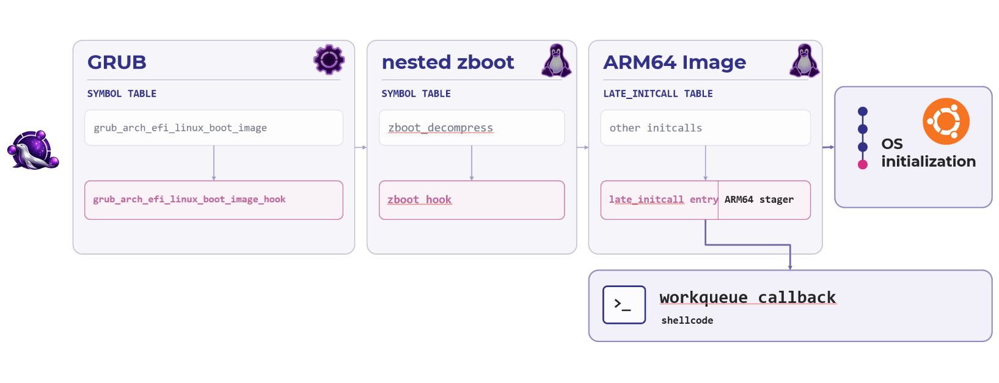

# Silverseal - Linux Bootkit Framework


  

Silverseal is an open-source Linux bootkit research framework written in Rust. It demonstrates how a UEFI bootkit hooks the Linux boot process to load a Rust kernel module. The repository contains:

- [`silverseal-bootkit/`](./silverseal-bootkit/): the `no_std` UEFI bootkit, with architecture-specific assembly under `asm/`.
- [`silverseal-rootkit/`](./silverseal-rootkit/): the Kbuild-managed Rust Linux kernel module.
- [`scripts/`](./scripts/): environment, deployment, and recovery helpers.

The project explores UEFI bootkit development, Linux boot-chain hooking, kernel-module loading, and pre-OS persistence in a research environment.

## Design



## x64 boot flow

1. `grubx64.efi` is replaced by `silverseal-bootkit.efi`; the original is retained as `grubx64.efi.original`.
2. The bootkit loads the saved GRUB image, hooks its Linux boot-image function, and starts GRUB. When GRUB takes its existing Linux boot path, the hook restores the original function and detours the kernel image's zstd decompressor.
3. After the decompressor returns, the bootkit locates a late-initcall entry in the decompressed kernel. It places a stager and worker in `.text` code caves, keeps their `work_struct` and arguments in a `.data` cave, and redirects that initcall entry to the stager.
4. During kernel initialization, the stager queues the worker with `schedule_work`, then jumps to the original initcall so it still runs.
5. The worker sleeps for 10 seconds, then calls `call_usermodehelper` to run `/sbin/insmod /silverseal_rootkit.ko` from the real root filesystem.

The x64 kernel hook uses signatures and layout assumptions from a specific Ubuntu kernel image. Matching build artifacts alone does not establish that the hook will work on another kernel; validate the target image and boot behavior in a disposable VM.

## ARM64 boot flow

ARM64 mirrors the existing x86 deployment model:

1. `grubaa64.efi` is replaced by `silverseal-bootkit.efi`; the original is retained as `grubaa64.efi.original`.
2. The bootkit chain-loads that original GRUB image and detours its existing Linux boot-image path. It does not add or require a GRUB menu entry.
3. The bootkit finds the stock ARM64 zboot PE inside the staged `vmlinuz` `.linux` section and observes its successful decompression into `vmlinux`.
4. The decompressed kernel is matched against the exact target profile. A late-initcall entry is redirected to a position-independent stager.
5. The stager initializes a kernel `work_struct` and calls the target kernel's `schedule_work.isra.0`. Its worker sleeps for 10 seconds, then invokes `/sbin/insmod /silverseal_rootkit.ko` from the real root filesystem.
6. The original initcall still runs.

## Prepare a build environment

On Ubuntu, `install_dependencies.sh` installs build packages, Rust and `rust-src`, and `bindgen-cli`. It also checks whether the running kernel advertises `CONFIG_RUST=y`. Review the script before running it because it installs packages and changes the default Rust toolchain:

```bash
./scripts/install_dependencies.sh
```

On WSL2 with Ubuntu, `wsl_setup.sh` prepares a custom Rust-enabled WSL2 kernel, a modules VHDX, and a build tree for external modules. It can optionally write a Windows `.wslconfig` entry. Review its options and the changes it makes before running it:

```bash
./scripts/wsl_setup.sh --help
./scripts/wsl_setup.sh
```

The pinned ARM64 Ubuntu target has a separate setup flow below. `ubuntu_target_setup.sh` runs natively in that ARM64 VM and derives the required Rust version from its kernel configuration; it is not a generic WSL cross-build helper.

## Build the ARM64 rootkit in the Ubuntu VM

Use the native ARM64 Ubuntu VM on Apple Silicon. The real module must be built through the target kernel's Kbuild tree, not with Cargo's IDE stub:

```bash
cd Silverseal
./scripts/ubuntu_target_setup.sh 7.0.0-31-generic

cd silverseal-rootkit
make clean ARCH=arm64 LLVM= KDIR=/lib/modules/7.0.0-31-generic/build
PATH=/usr/bin:/bin:$PATH \
RUST_LIB_SRC=/path/printed/by/ubuntu_target_setup.sh \
make RUST_MIN_TOOLCHAIN= \
  ARCH=arm64 \
  LLVM= \
  KDIR=/lib/modules/7.0.0-31-generic/build \
  RUSTC=rustc-1.93 \
  RUSTDOC=rustdoc-1.93
```

Confirm that Kbuild produced the module for the pinned kernel:

```bash
file target/arm64/7.0.0-31-generic/silverseal_rootkit.ko
modinfo target/arm64/7.0.0-31-generic/silverseal_rootkit.ko | grep vermagic
```

Before runtime testing, validate the target kernel's `work_struct` layout from its BTF or DWARF: size 32 bytes, `entry` at offset 8, and `func` at offset 24. A mismatch is a hard stop because those values are encoded by the stager.

## Build the ARM64 bootkit on macOS

Apple Silicon can build the AArch64 UEFI binary directly. Install stable Rust with the `aarch64-unknown-uefi` target and PowerShell (`pwsh`) for fixture verification.

The large pinned artifacts are expected in `tmp/silverseal-kernel-7.0.0-31-generic/`. Generate the v3 profile after verifying their hashes, unique signatures, nested stock-zboot PE, caves, initcall, and linked System.map evidence:

```bash
cd Silverseal
pwsh ./scripts/verify_arm64_fixture.ps1 \
  -ArtifactDirectory ./tmp/silverseal-kernel-7.0.0-31-generic \
  -OutputDirectory ./target/arm64-fixture/7.0.0-31-generic-v3

export SILVERSEAL_ARM64_PROFILE="$PWD/target/arm64-fixture/7.0.0-31-generic-v3/7.0.0-31-generic.ssarm64p"
cargo build-bootkit-arm64 --release
```

The result is:

```text
target/aarch64-unknown-uefi/release/silverseal-bootkit.efi
```

An ARM64 build with no `SILVERSEAL_ARM64_PROFILE` deliberately installs no hook. The profile and small signature fixtures live under `fixtures/arm64/7.0.0-31-generic/`; the large kernel and GRUB artifacts remain ignored.

Host-side contracts can be run with:

```bash
cargo test-arm64
cargo test -p silverseal-bootkit --bin silverseal-arm64-tool --features arm64-tools
```

## Deploy in the ARM64 Ubuntu VM

Copy the bootkit and module into the VM, then put the module on the real root filesystem and replace the existing ARM64 GRUB binary:

```bash
sudo install -m 0644 \
  silverseal-rootkit/target/arm64/7.0.0-31-generic/silverseal_rootkit.ko \
  /silverseal_rootkit.ko

sudo ./scripts/setup_silverseal.sh arm64 \
  target/aarch64-unknown-uefi/release/silverseal-bootkit.efi
sudo reboot
```

Do not create a menu entry and do not rebuild initramfs. The VM should boot its normal existing Ubuntu entry. After boot, inspect the module result with:

```bash
sudo dmesg -w
lsmod | grep silverseal_rootkit
```

To restore the saved original GRUB image:

```bash
sudo ./scripts/restore_silverseal.sh arm64
```

The restore helper keeps the replaced image as `grubaa64.efi.silverseal` for recovery.

## Serial logs with VMware Fusion on macOS

Add a virtual serial port to the powered-off ARM64 VM and configure its output to a file on macOS. The bootkit discovers the firmware's UEFI Serial I/O protocol; it does not assume QEMU's PL011 MMIO address. If Fusion firmware exposes no Serial I/O protocol, logging is silently disabled and boot continues.

On macOS, watch the configured output file while the VM boots:

```bash
touch /path/to/fusion-serial.log
tail -F /path/to/fusion-serial.log
```

This captures bootkit messages before Linux starts. Once Linux is available, `sudo dmesg -w` in the VM is the simpler source for the delayed worker and module logs. QEMU is not required by this workflow.

## x86_64

The x86 UEFI build requires `nasm` on `PATH` and assembles the x64 loader and stager into the EFI image:

```bash
cargo build-bootkit-x64 --release
```

The resulting image is `target/x86_64-unknown-uefi/release/silverseal-bootkit.efi`. Build the real module through the target kernel's Rust-enabled Kbuild tree, using matching headers and tools:

```bash
make -C silverseal-rootkit ARCH=x86_64 KDIR=/path/to/target/kernel/build
modinfo silverseal-rootkit/target/x86_64/<kernel-release>/silverseal_rootkit.ko | grep vermagic
```

The Makefile stages module artifacts under `silverseal-rootkit/target/x86_64/<kernel-release>/`. `cargo check -p silverseal-rootkit` checks only the IDE stub; it does not build a loadable module. For an Ubuntu generic kernel, match the target kernel's Rust version and `RUST_LIB_SRC` as well as its headers. The pinned ARM64 setup command above is specific to that VM.

From the repository root in a disposable x86_64 VM, deploy the EFI image by passing its path to the setup script:

```bash
sudo ./scripts/setup_silverseal.sh x86_64 \
  target/x86_64-unknown-uefi/release/silverseal-bootkit.efi
```

The script saves `/boot/efi/EFI/ubuntu/grubx64.efi` as `grubx64.efi.original` and installs the bootkit in its place. To restore the original GRUB image:

```bash
sudo ./scripts/restore_silverseal.sh x86_64
```

The restore helper retains the replaced image as `grubx64.efi.silverseal` for recovery.

## Serial logs on x86_64

With a VM serial port configured, Linux hosts can inspect `/dev/ttyS*` and monitor the corresponding port at 115200 baud using `minicom`, `screen`, or `picocom`:

```bash
ls -la /dev/ttyS*
sudo minicom -D /dev/ttyS0 -b 115200
```

On a Windows host with a VM serial pipe at `\\.\pipe\com_1`, PuTTY can open a Serial connection at 115200 baud with no flow control. The reconnecting helper uses that fixed pipe path and requires PuTTY at `C:\Program Files\PuTTY\putty.exe`:

```powershell
powershell -ExecutionPolicy Bypass -File .\scripts\connect-vm.ps1
```

## Resources

- [UEFI crate](https://rust-osdev.github.io/uefi-rs/how_to/protocols.html)
- [Elixir Bootlin](https://elixir.bootlin.com/linux)
- [memN0p's Bootkit](https://github.com/memN0ps/redlotus-rs)
